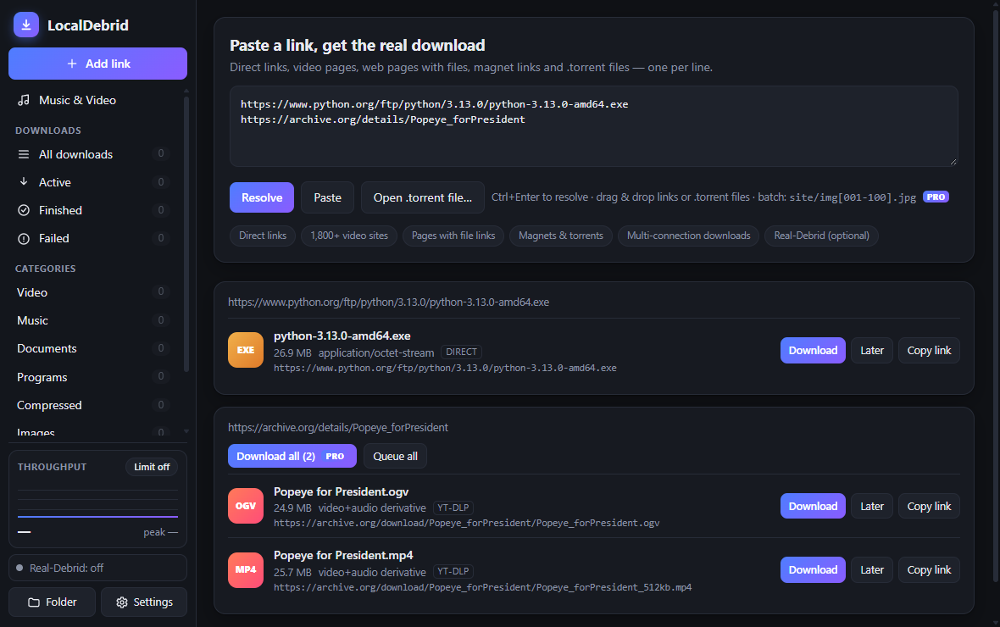
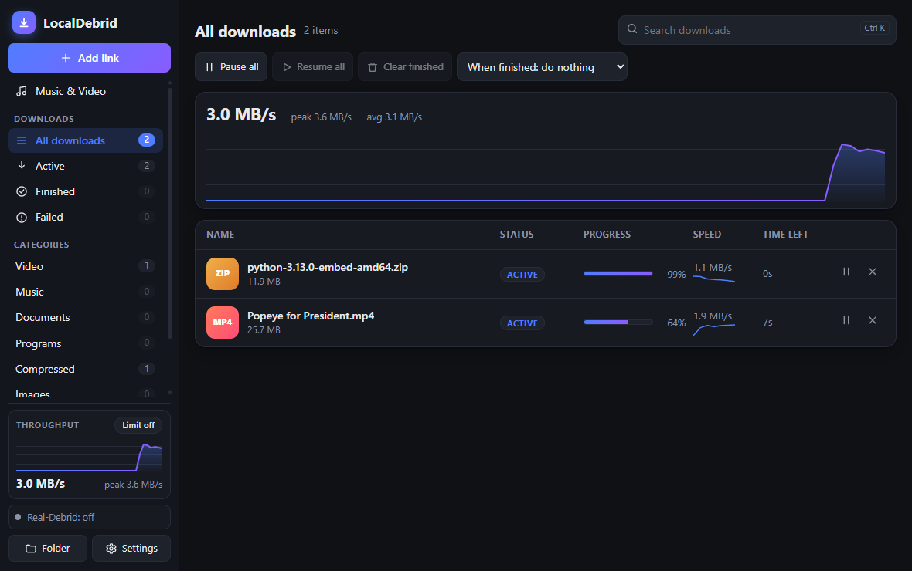
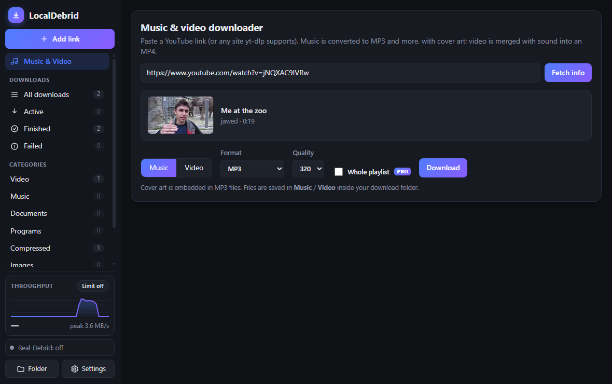

# LocalDebrid

**A fast, friendly download manager for Windows** — paste a link, get the real download. Multi-connection downloads, torrents, music & video grabber, a browser extension that captures downloads like IDM, and automatic updates. Everything runs on your own PC.

**[⬇ Download the latest version](https://github.com/joehezzarry/ld-licenses/releases/latest/download/LocalDebrid-share.zip)** · [All releases](https://github.com/joehezzarry/ld-licenses/releases) · [Install](#install) · [Browser extension](#browser-extension) · [Free vs Pro](#free-vs-pro) · [Troubleshooting](#troubleshooting) · [Privacy & legal](#privacy--legal)

Windows 10 / 11 (64-bit) · no installer · about 60 MB download (the zip includes FFmpeg for music conversion)

## What it does

| You paste or click | What happens |
|---|---|
| A normal file link | Downloaded with up to 16 parallel connections, pause / resume, auto-retry |
| A video or music page (YouTube and ~1,800 other sites) | **Music & Video** page: MP3, M4A, Opus, FLAC or WAV with cover art — or an H.264 MP4 at the resolution you choose |
| Any web page with files on it | Scanned for the file links, embedded players and hidden media URLs |
| A magnet link or `.torrent` | Pick the files, download to your PC; each finished file also gets a local direct link |
| A link in your browser | The **browser extension** hands it to LocalDebrid (with your cookies, so logged-in downloads work) |

**Also included:** live throughput graph and per-download sparklines · speed limiter with one-click on/off · categories, search and filters · optional Real-Debrid support with *your own* account · send to Internet Download Manager if you have it · signed automatic updates.

## Install

1. [Download the zip](https://github.com/joehezzarry/ld-licenses/releases/latest/download/LocalDebrid-share.zip) and **extract it to a normal folder** (Desktop, Documents, `C:\Tools` — not *Program Files*, so the app can update itself).
2. Keep `ffmpeg.exe` **next to** `LocalDebrid.exe` (needed for MP3 conversion and HD video merging).
3. Double-click `LocalDebrid.exe`. Read and accept the terms of use on first start.

Downloads go to `Downloads\LocalDebrid` (change it in **Settings**). Closing the window quits the app; unfinished downloads resume next time.

**Windows may warn you:** the app is not code-signed, so SmartScreen can say *Unknown publisher* → click **More info → Run anyway**. Some antivirus tools are suspicious of any packaged Python app; if yours blocks it, add an exception for the folder.

## Browser extension

Works in **Chrome, Edge, Brave, Opera** (Chromium browsers). It captures downloads like IDM, adds a right-click **Download with LocalDebrid**, and shows a badge when it finds videos on a page.

1. In LocalDebrid open **Settings → Browser**.
2. Open your browser's extensions page (`chrome://extensions` or `edge://extensions`), switch on **Developer mode**, click **Load unpacked** and choose the folder shown in that Settings page.
3. Click the LocalDebrid toolbar icon and paste the **pairing code** from Settings → Browser.

If LocalDebrid isn't running, nothing is intercepted — your browser downloads normally. The extension updates itself together with the app. More detail: [docs/EXTENSION.md](docs/EXTENSION.md).

## Updates

LocalDebrid checks for new versions on its own, downloads them, verifies a digital signature and the file's checksum, and offers **Restart & update** (or installs at the next start). Nothing to do manually. *Settings → About* has **Check for updates** and an automatic on/off switch.

## Free vs Pro

Everything below the line is free forever. A few extras need a **license key** (or unlock during a free **14-day trial** that starts the first time you run the app):

| Free | Pro |
|---|---|
| Downloads, torrents, Music & Video (single items), browser extension, speed limiter, throughput graph, Real-Debrid, auto-update | Playlist downloads · download scheduler & **Later** queue · clipboard link monitor · batch patterns (`site/img[001-100].jpg`) and **Download all** · *when finished* exit / sleep / shut down |

To get a key, open **Settings → License**, copy your **Machine ID** and send it to whoever shared the app with you; paste the key you get back and press **Activate**.

## Optional: Real-Debrid

If you have your own [Real-Debrid](https://real-debrid.com) account, add your API token in **Settings → Real-Debrid**. Magnets, torrents and supported file hosts are then fetched by their servers (instant when cached) and downloaded to your PC at full speed. Use your own account — sharing one breaks their rules. LocalDebrid is not affiliated with Real-Debrid.

## Where things live

| What | Where |
|---|---|
| Your downloads | `Downloads\LocalDebrid` (changeable) |
| Settings, license key, logs (`app.log`), browser-extension copy | `%LOCALAPPDATA%\LocalDebrid` |
| Uninstall | Delete the app folder, and `%LOCALAPPDATA%\LocalDebrid` if you want to remove settings |

## Troubleshooting

* **"Windows protected your PC"** → *More info → Run anyway* (unsigned app, see above).
* **A firewall prompt for `aria2c.exe`** appears the first time you use a torrent. Choose *Allow* on private networks; you're asked once. Normal downloads never need it.
* **A torrent is very slow** → a torrent with one seeder is slow in any client. Real-Debrid (above) fetches cached torrents at full speed.
* **MP3 / merged video is greyed out or "ffmpeg not found"** → put `ffmpeg.exe` in the same folder as `LocalDebrid.exe`.
* **A video site stops working** → sites change often; update the app (Settings → About → Check for updates).
* **Private or login-only videos** → put a Netscape-format `cookies.txt` in `%LOCALAPPDATA%\LocalDebrid`.
* **The extension says "not paired" or "not running"** → start LocalDebrid first, then paste the pairing code from *Settings → Browser* again. *New code* in that page replaces a leaked code.
* **The update can't install** → the app must be in a folder Windows lets it write to (not *Program Files*).

## Privacy & legal

* **No telemetry, no accounts, no ads.** The app contacts only the sites you download from, GitHub (this repository) to check for updates and for the license revocation list, and Real-Debrid if you turn it on. Your settings, license key and Real-Debrid token stay on your PC.
* **Only download what you have the right to.** You are responsible for what you download and for following the terms of the sites you use. See the [terms of use](EULA.txt).
* **Open-source components** are used under their own licenses — see [THIRD_PARTY_NOTICES.txt](THIRD_PARTY_NOTICES.txt) and the [`licenses/`](licenses) folder: aria2 (GPLv2) · FFmpeg (GPLv3 build) · yt-dlp (Unlicense) · pywebview (BSD) · pythonnet (MIT) · cryptography (Apache/BSD).
  * aria2 1.37.0 source: <https://github.com/aria2/aria2/releases/tag/release-1.37.0>
  * FFmpeg 7.1 source: <https://ffmpeg.org/releases/ffmpeg-7.1.tar.xz> (build by gyan.dev: <https://www.gyan.dev/ffmpeg/builds/>)
  * These programs are shipped unmodified as separate executables. On request the distributor will provide the corresponding source for the exact binaries shipped.

## About this repository

This page hosts the downloads and the small service files the app reads:

| File | Purpose |
|---|---|
| **[Releases](https://github.com/joehezzarry/ld-licenses/releases)** | The app, the full zip and the extension zip |
| `update.json` | Signed notice of the newest version (read by the app's updater — don't edit) |
| `revocations.json` | Signed list of cancelled license keys (read by the app — don't edit) |
| `docs/` | Browser-extension guide and screenshots |
| `EULA.txt`, `THIRD_PARTY_NOTICES.txt`, `licenses/` | Terms and open-source notices |

*LocalDebrid is a personal hobby project shared with friends. It is provided as-is, without warranty.*
